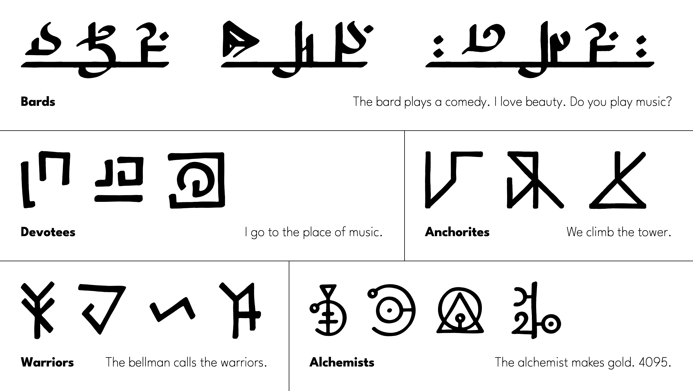

# Scripts of Sennaar

Five installable fonts for the invented scripts of the game [Chants of Sennaar](https://www.rundisc.io/chants-of-sennaar/), redrawn with a pen model so they read as writing. You can also write forms the game never had, such as *place + music*.

> [!WARNING]
> This repository spoils the game's language puzzles: the image and word lists show what the signs mean.



These are unofficial fan fonts, not affiliated with Rundisc or Focus Entertainment.

## The fonts

Each font comes as TTF, WOFF and WOFF2.

| Font | Signs | How it writes | Word order |
| --- | ---: | --- | --- |
| [Script of Anchorites](fonts/script-of-anchorites) | 32 forms, 16 strokes | Strokes on a grid share one tile | |
| [Script of Devotees](fonts/script-of-devotees) | 34 forms | Person, object, place and verb frames around a root | Subject, verb, object |
| [Script of Warriors](fonts/script-of-warriors) | 36 forms | Person and action marks around a root | Subject, verb, object |
| [Script of Bards](fonts/script-of-bards) | 42 forms | Signs join along one line, with dots and descenders | Object, subject, verb |
| [Script of Alchemists](fonts/script-of-alchemists) | 32 words, numbers 0–9999 | Category shapes around a root, and one stem per number | Subject, verb, object |

## Typing

Install a TTF and pick its family in your editor. Then type a word's code between colons:

```text
:god: :see: :you:
```

Plain digits work in Script of Alchemists: `4095` writes one number. In Script of Bards, one space joins signs on the line, `?` writes the question sign, and Latin text runs on the line.

Codes use OpenType required ligatures (`rlig`), which most text engines turn on by themselves. An unknown code stays as text.

## Writing new forms

Join a category and roots with `+`. The form does not have to exist in the game, and the font builds it as you type.

```text
:place:+:music:
:place:+:music:+:go:
:element:+1234
:me:+:go:+:not:
```

A frame holds up to four roots side by side. Put the category first. New forms have no fixed meaning, so you decide what they say. Parts are per script: Script of Warriors has a music sign but no place category.

## Codes

<details>
<summary>Script of Anchorites: 32 words</summary>

`:me:` `:you:` `:plural:` `:not:` `:go:` `:up:` `:dead:` `:seek:` `:people:` `:door:` `:human:` `:greetings:` `:fear:` `:wait:` `:help:` `:make:` `:open:` `:key:` `:stop:` `:talk:` `:tower:` `:exile:` `:we:` `:stranger:` `:peoples:` `:our-people:` `:die:` `:revive:` `:disregard:` `:come:` `:climb:` `:doors:`

</details>

<details>
<summary>Script of Devotees: 34 words</summary>

`:you:` `:vase:` `:warrior:` `:up:` `:talk:` `:seek:` `:see:` `:potion:` `:preacher:` `:plant:` `:open:` `:not:` `:music:` `:me:` `:human:` `:make:` `:love:` `:lens:` `:key:` `:instrument:` `:help:` `:greetings:` `:god:` `:go:` `:find:` `:garden:` `:door:` `:devotee:` `:dead:` `:close:` `:cemetery:` `:church:` `:abbey:` `:free:`

Categories, used with `+`: `:verb:` `:object:` `:place:` `:person:`

</details>

<details>
<summary>Script of Warriors: 36 words</summary>

`:vessel:` `:weapon:` `:warrior:` `:wait:` `:treasure:` `:sun:` `:small:` `:seek:` `:scientist:` `:trolley:` `:protect:` `:push:` `:plural:` `:not:` `:moon:` `:music:` `:make:` `:lay:` `:love:` `:key:` `:instrument:` `:impure:` `:help:` `:go:` `:fortress:` `:fear:` `:duty:` `:dead:` `:chosen:` `:carry:` `:call:` `:box:` `:bottle:` `:big:` `:bellman:` `:balance:`

Categories, used with `+`: `:person:` `:verb:` `:inverted-person:`

</details>

<details>
<summary>Script of Bards: 42 words</summary>

`:you:` `:weapon:` `:music:` `:warrior:` `:windmill:` `:west:` `:question:` `:theater:` `:south:` `:seek:` `:saw:` `:plural:` `:pliers:` `:play:` `:path:` `:not:` `:north:` `:monster:` `:me:` `:human:` `:love:` `:instrument:` `:idiot:` `:hammer:` `:go:` `:greetings:` `:fortress:` `:free:` `:fire:` `:find:` `:east:` `:compass:` `:comedy:` `:carry:` `:beauty:` `:brother:` `:book:` `:be:` `:bard:` `:climb:` `:agora:` `:abbey:`

Categories, used with `+`: `:person:` `:verb:` `:place:`

</details>

<details>
<summary>Script of Alchemists: 32 words</summary>

`:you:` `:warrior:` `:transform:` `:silver:` `:seek:` `:refectory:` `:plural:` `:plant:` `:open:` `:not:` `:mine:` `:monster:` `:me:` `:make:` `:library:` `:laboratory:` `:help:` `:gold:` `:formula:` `:fire:` `:find:` `:fear:` `:fairy:` `:door:` `:dead:` `:copper:` `:close:` `:carbon:` `:book:` `:brother:` `:bard:` `:alchemist:`

Categories, used with `+`: `:verb:` `:place:` `:person:` `:group:` `:element:`

</details>

## Where it works

Checked in Chrome, HarfBuzz and CoreText. Firefox, Safari, Word, InDesign and Figma are not tested yet.

In Chrome, the first letter code typed straight after a pasted private-use sign can stay as letters. Later codes on the line work.

## Credits

- Fonts and redrawing: Michał Sadurski
- Original signs: Julien Moya, for Chants of Sennaar (Rundisc / Focus Entertainment)
- Starting point for the redrawing: vector copies of those signs by Dercomai and Kekeee

## Licence

The fonts are under the [SIL Open Font License 1.1](OFL.txt). The licence covers this redrawing and cannot grant rights in the game, its name or Rundisc's own artwork.
